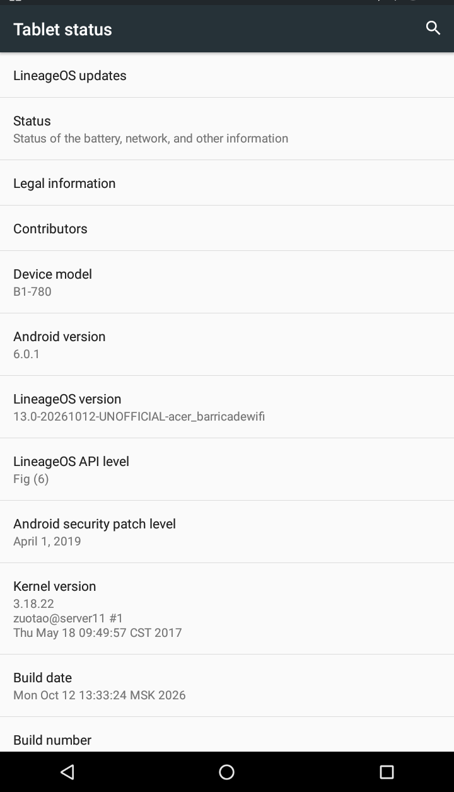

# LineageOS 13 for Acer Iconia One 7 B1-780

Unofficial **LineageOS 13 / Android 6.0.1** port for the **Acer Iconia One 7 B1-780 Wi-Fi** (`acer_barricadewifi`, MediaTek MT8163). It is built for the Wi-Fi-only tablet and does not expose SIM or cellular settings.

## Hardware status

| Component | Status |
|---|---|
| Display and touchscreen | Working |
| On-screen navigation buttons | Working |
| Wi-Fi | Working |
| Bluetooth | Working |
| Speaker and media audio | Working |
| Rear camera | Working; preview and JPEG capture tested |
| Front camera | Working; preview and JPEG capture tested |
| Battery percentage and charging state | Working |
| Charge LED | Red while charging, green at full |
| USB ADB/MTP | Working |
| Cellular/SIM | Hidden; this hardware has no SIM slot |

The port uses the Acer Android 6 kernel and proprietary MT8163 hardware modules. Source patches and reproducible overlay/build scripts are included; Acer proprietary blobs must be extracted from the owner’s stock firmware.

## Installation

See [docs/INSTALL.md](docs/INSTALL.md). Install the [B1-780 TWRP build](https://github.com/svesnav/acer-b1-780-twrp/releases/latest) first and make an off-device backup.

## Release files

- `lineage-13.0-b1-780-boot.img`
- `lineage-13.0-b1-780-system.img.7z` (extracts to the raw system image)
- `SHA256SUMS.txt`

This is an unofficial community port for one exact tablet model. The Android security patch level is April 1, 2019, so it should not be treated as a current security-hardened OS.
